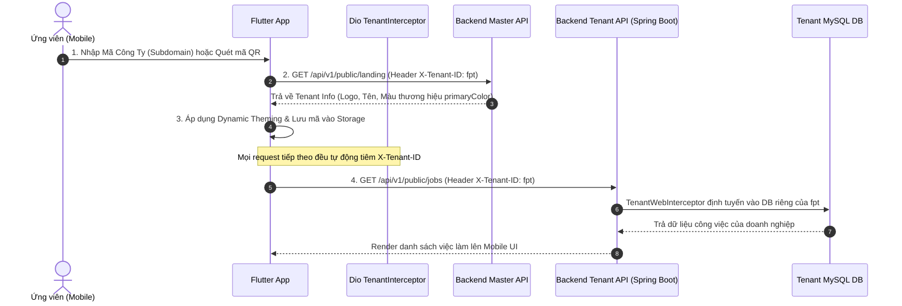

# SmartHire Candidate Mobile App

[](https://flutter.dev)
[](https://dart.dev)
[](#kiến-trúc-dự-án)
[](../SmartHire-AI)

Ứng dụng di động dành riêng cho **Ứng viên (CANDIDATE)** trong hệ sinh thái nền tảng tuyển dụng SaaS Multi-Tenant **SmartHire-AI**. Ứng dụng hỗ trợ tìm việc làm, nộp hồ sơ, theo dõi tiến độ ứng tuyển, làm bài test kỹ thuật và thực hiện phỏng vấn AI ngay trên điện thoại.

---

## 🎯 Đối Tượng Sử Dụng (Actor)

Ứng dụng này được thiết kế và tối ưu hoá chuyên biệt cho **duy nhất 1 Actor: Ứng viên (`CANDIDATE`)**:
* Tìm kiếm và khám phá các vị trí tuyển dụng của từng doanh nghiệp.
* Nộp đơn ứng tuyển và tải lên CV (PDF).
* Theo dõi trạng thái hồ sơ qua các vòng tuyển dụng (Pipeline Stages) cùng **Điểm phù hợp AI (AI Matching Score)**.
* Tham gia làm bài kiểm tra năng lực kỹ thuật trực tuyến (Technical Assessment — FE-05).
* Phòng luyện phỏng vấn và phỏng vấn chính thức với AI (AI Interview Room) qua âm thanh và video.

---

## 🏛️ Kiến Trúc Multi-Tenant Trên Mobile

Ứng dụng kết nối trực tiếp vào hệ thống Backend Spring Boot 3.3 Multi-Tenant của `SmartHire-AI` (sử dụng cơ chế **Separate Database per Tenant** — mỗi doanh nghiệp một cơ sở dữ liệu MySQL riêng biệt).

### Luồng hoạt động 4 bước (Tenant Resolution Flow)



1. **Bước 1 — Chọn Doanh Nghiệp & Quét QR (`Tenant Selection`):**
   * Khi mở app lần đầu (hoặc đổi doanh nghiệp), ứng viên nhập mã công ty (ví dụ: `fpt`, tương ứng với `fpt.smarthire.top` trên web) hoặc quét mã QR từ standee tuyển dụng / website của công ty.
2. **Bước 2 — Lookup Tenant & Dynamic Theming (`Brand Adoption`):**
   * App gọi `GET /api/v1/public/landing` kèm header `X-Tenant-ID: <code_or_subdomain>`.
   * Lấy về thông tin nhận diện: Tên công ty, Logo, Slogan và mã màu thương hiệu (`theme.primaryColor`).
   * App tự động chuyển đổi màu chủ đạo (Dynamic Theming) để mang lại cảm giác ứng dụng chuyên biệt của chính doanh nghiệp đó.
3. **Bước 3 — Gắn Header Cố Định (`Dio Interceptor`):**
   * `tenant_code` được lưu trữ vào bộ nhớ thiết bị.
   * Lớp mạng `DioClient` trang bị `TenantInterceptor` tự động đính kèm header `X-Tenant-ID: <code>` và `Authorization: Bearer <jwt_token>` (nếu đã đăng nhập) vào **mọi HTTP request**.
4. **Bước 4 — Routing Tự Động Phía Backend (`Spring Boot Multi-Tenancy`):**
   * Phía Backend Spring Boot, `TenantWebInterceptor` đọc header `X-Tenant-ID` và kích hoạt `TenantContext.setCurrentTenant(...)`.
   * Hibernate và `DynamicMultiTenantConnectionProvider` tự động bốc đúng DataSource MySQL của doanh nghiệp đó. Toàn bộ dữ liệu `jobs`, `applications`, `cvs`, `assessments`, `interviews` được tái sử dụng 100% như phiên bản Web.

---

## 🛠️ Tech Stack & Thư Viện

| Thành phần | Công nghệ / Thư viện | Vai trò |
|---|---|---|
| **Framework** | Flutter 3.x (Dart 3.x) | Phát triển đa nền tảng (Android & iOS) |
| **Kiến trúc mã nguồn** | Clean Architecture & Feature-First | Tách biệt ranh giới nghiệp vụ, dễ mở rộng và bảo trì |
| **Quản lý trạng thái** | `flutter_bloc` & `equatable` | State management dạng reactive, dễ viết test |
| **Điều hướng & Routing** | `go_router` | Hỗ trợ Deep Links, StatefulShellRoute (Bottom Bar) và Navigation Guards |
| **Giao tiếp mạng (HTTP)** | `dio` & `pretty_dio_logger` | Quản lý request/response, Interceptors tiêm Tenant & Auth token |
| **Lưu trữ dữ liệu** | `flutter_secure_storage` & `shared_preferences` | Lưu trữ an toàn JWT Token và cache cấu hình tenant |
| **Dependency Injection** | `get_it` | Service locator đăng ký Repositories, Services và Blocs |
| **Quét mã QR** | `mobile_scanner` | Quét mã QR tuyển dụng qua Camera |
| **Giao diện & Typography** | `google_fonts` (Inter) & Material 3 | Áp dụng chính xác Design Tokens từ `DESIGN.md` (Luminous Professional) |
| **Hiển thị hình ảnh** | `cached_network_image` | Tải và lưu cache logo, banner của doanh nghiệp |

---

## 📁 Cấu Trúc Thư Mục Dự Án

```text
lib/
├── core/                                   # Nền tảng chia sẻ toàn app
│   ├── constants/
│   │   └── api_constants.dart              # Base URL, header keys & API endpoints
│   ├── di/
│   │   └── injection.dart                  # Cấu hình Service Locator GetIt
│   ├── network/
│   │   └── dio_client.dart                 # Cấu hình Dio, TenantInterceptor & AuthInterceptor
│   ├── routes/
│   │   └── app_router.dart                 # Định tuyến GoRouter (StatefulShellRoute 4 tab)
│   ├── storage/
│   │   └── storage_service.dart            # Quản lý Secure Storage (Tokens) & SharedPreferences
│   └── theme/
│       └── app_theme.dart                  # Design tokens (Luminous Professional) & Dynamic Theming
│
├── features/                               # Kiến trúc phân tách theo Tính năng (Feature-First)
│   ├── tenant/                             # [Bước 1 & 2] Chọn công ty & Quét QR
│   │   ├── bloc/                           # TenantBloc, Event, State
│   │   ├── models/tenant_info.dart         # Thông tin thương hiệu công ty
│   │   ├── repositories/tenant_repository.dart
│   │   └── views/
│   │       ├── tenant_selection_screen.dart # Màn hình nhập mã + cấu hình kết nối API
│   │       └── qr_scanner_screen.dart       # Màn hình camera quét mã QR tuyển dụng
│   │
│   ├── auth/                               # Xác thực tài khoản ứng viên
│   │   ├── bloc/auth_bloc.dart             # Quản lý trạng thái đăng nhập
│   │   ├── models/user_model.dart          # Thông tin profile ứng viên
│   │   ├── repositories/auth_repository.dart # POST /tenant/auth/login, logout, /me
│   │   └── views/login_screen.dart         # Đăng nhập hoặc Duyệt dưới quyền Khách (Guest)
│   │
│   ├── jobs/                               # Khám phá việc làm & Nộp hồ sơ
│   │   ├── bloc/job_bloc.dart
│   │   ├── models/job_model.dart
│   │   ├── repositories/job_repository.dart # GET /public/jobs và POST nộp đơn ứng tuyển
│   │   └── views/
│   │       ├── job_list_screen.dart        # Danh sách tin tuyển dụng, tìm kiếm, pull-to-refresh
│   │       ├── job_detail_screen.dart      # Chi tiết công việc, kỹ năng yêu cầu, nộp hồ sơ
│   │       └── widgets/job_card.dart
│   │
│   ├── applications/                       # Theo dõi hồ sơ đã ứng tuyển
│   │   ├── models/application_model.dart   # Pipeline stage, AI Matching score
│   │   ├── repositories/application_repository.dart # GET /applications/me, rút hồ sơ
│   │   └── views/my_applications_screen.dart # Danh sách hồ sơ & tiến độ vòng tuyển dụng
│   │
│   ├── assessments/                        # Bài kiểm tra kỹ thuật (FE-05) & Phỏng vấn AI
│   │   └── views/candidate_assessment_list_screen.dart
│   │
│   ├── profile/                            # Trang cá nhân & Quản lý doanh nghiệp
│   │   └── views/profile_screen.dart       # Đổi doanh nghiệp, đăng xuất, thông tin app
│   │
│   └── shell/                              # Vỏ điều hướng chính
│       └── views/main_shell_screen.dart    # Thanh NavigationBar 4 tab cố định
│
└── main.dart                               # Entrypoint: MultiBlocProvider & Dynamic Theme App
```

---

## 🚀 Hướng Dẫn Khởi Chạy

### 1. Yêu cầu môi trường
* **Flutter SDK:** 3.12+ (kênh stable)
* **Dart SDK:** 3.12+
* **Android Studio / VS Code** cùng thiết bị Android Emulator hoặc điện thoại thật.
* Backend `SmartHire-AI` đang chạy trên máy chủ local (`http://localhost:8080`) hoặc VPS (`https://smarthire.top`).

### 2. Cài đặt các gói phụ thuộc
```bash
flutter pub get
```

### 3. Kiểm tra chất lượng mã nguồn
```bash
# Kiểm tra cú pháp và linter
flutter analyze

# Chạy kiểm thử tự động
flutter test
```

### 4. Cấu hình địa chỉ Backend API
Khi chạy ứng dụng, bạn có thể dễ dàng chuyển đổi địa chỉ máy chủ API bằng cách nhấn vào biểu tượng **Bánh răng (Settings)** ở góc phải màn hình Chọn Doanh Nghiệp:
* **Android Emulator:** `http://10.0.2.2:8080/api/v1` *(Mặc định)*
* **Thiết bị thật cùng mạng Wi-Fi:** `http://<IP_LAN_CỦA_MÁY_TÍNH>:8080/api/v1`
* **Production Cloud:** `https://smarthire.top/api/v1`

### 5. Chạy ứng dụng
```bash
flutter run
```

---

## 📄 Bản Quyền & Giấy Phép

Phát triển bởi đội ngũ **SmartHire-AI**. Được phân phối theo giấy phép [MIT License](LICENSE).
